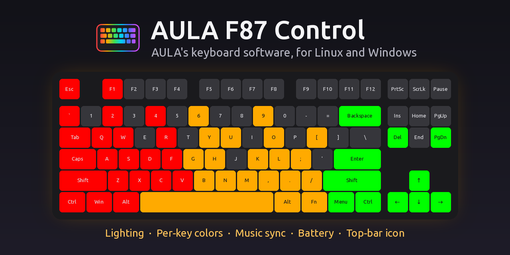
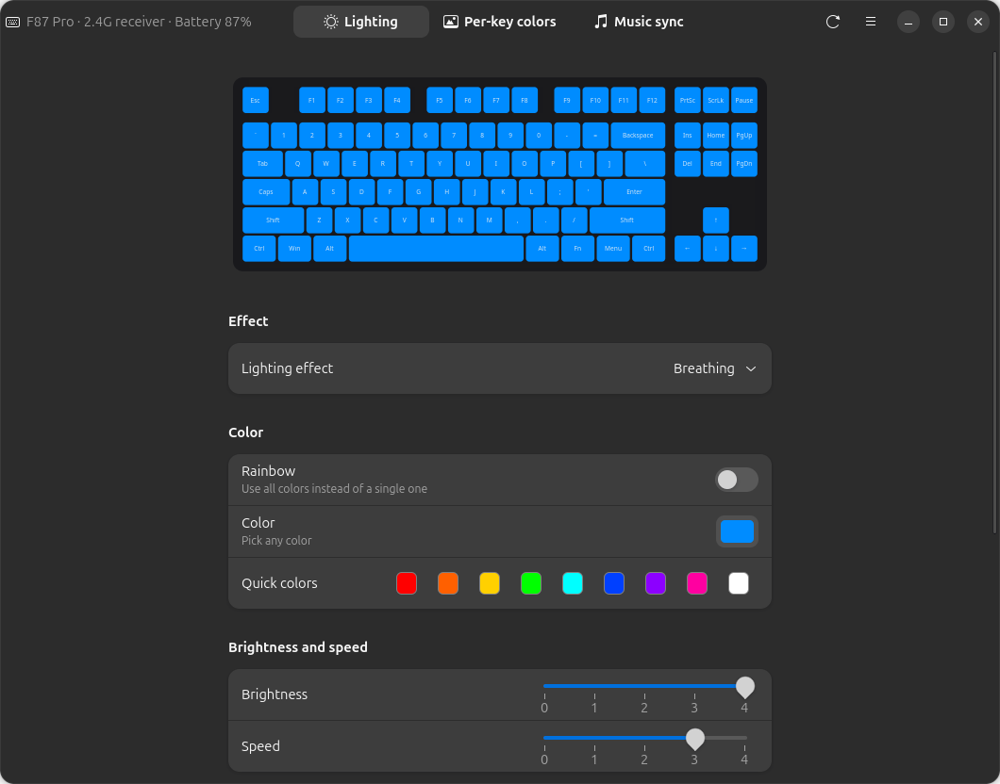
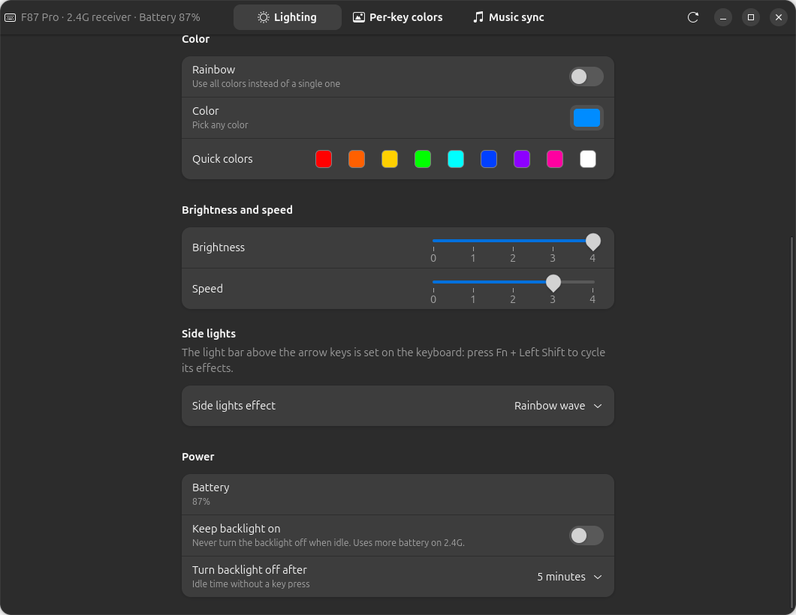
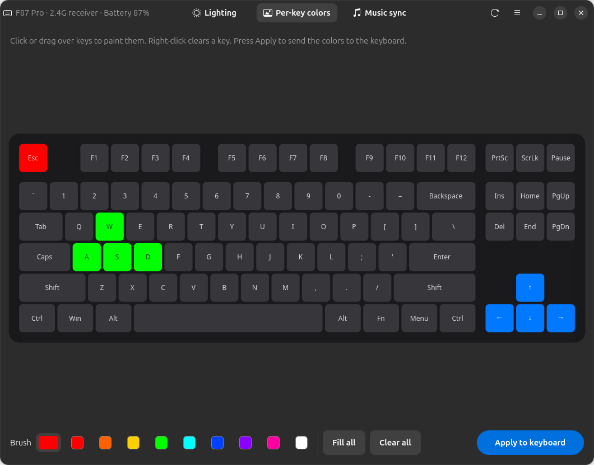
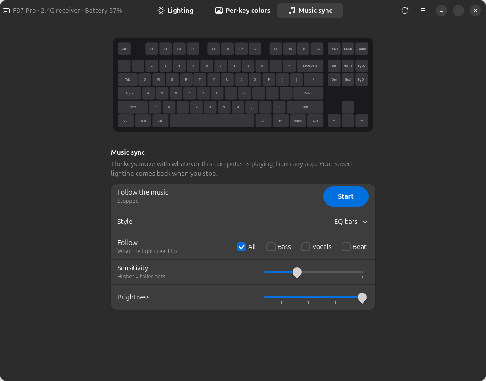

#  AULA F87 Control (Rust)

[](https://github.com/RadianceADM/aula-f87-control-rs/actions/workflows/ci.yml)
[](https://crates.io/crates/aula-f87-control)
[](LICENSE)

This app controls the lighting of the **AULA F87 / F87 Pro** mechanical keyboard on **Linux**,
without AULA's own software. It's the Rust version of
[AULA F87 Control](https://github.com/RadianceADM/aula-f87-control). It has the same GNOME window
and top-bar icon, the same features and the same settings files, with a Rust back end.



## Why Rust?

The lights react to music just as quickly as in the Python version, because the keyboard's frame
rate sets that. The Rust version is lighter:

| | Rust | Python |
|---|---|---|
| Whole app, music sync on (top-bar icon, window closed) | 0.4 % CPU, 51 MB | 2.2 % CPU, 84 MB |
| Music sync engine alone, on a test signal | 0.4 % CPU, 4 MB | 5.5 % CPU, 31 MB |
| Start-up | 0.1 s | 0.4 s |
| Install | one 2 MB program | Python, PyGObject, NumPy |

Percentages are of one CPU core. Most of the app's memory is GTK itself, so the gap is smaller
there than for the engine.

[docs/COMPARISON.md](docs/COMPARISON.md) has the measurements and how to repeat them. The Python
version is still the one to use on **Windows**.

## Features

- **Lighting effects.** 14 built-in effects in any color or rainbow, with brightness and speed.
  Changes are sent to the keyboard as you click.
- **Per-key colors.** Paint individual keys on an on-screen keyboard.
- **Music sync.** The keys move with whatever your computer is playing, from any app. Styles:
  EQ bars, meter colors, rainbow, and beat pulse. Choose what it follows: everything, the bass,
  the vocals or the beat. Close the window and the keyboard goes back to its own lighting.
- **Battery level** (over 2.4G) and **sleep timer.** Keep the backlight always on, or choose
  when it turns off.
- **Side lights** effect.
- **Top-bar icon.** A quick menu for music sync, keep backlight on, colors, effects and
  brightness, with the battery % next to the icon. It starts at login and stays in the top bar
  when you close the window.
- Works over the **USB cable** and the **2.4G receiver**.
- A **command line** for scripts and shortcuts.
- Needs no drivers and no admin rights once set up. Settings are stored in the keyboard
  itself, so they stay when you unplug it or use another computer.
- **Guards the keyboard's settings.** Every change is checked before it is written and read back
  afterwards. If something goes wrong, the last good settings are put back. See
  [Is it safe?](#is-it-safe)

## Supported keyboards

| Keyboard | USB cable | 2.4G receiver | Bluetooth |
|---|---|---|---|
| AULA F87 Pro | ✅ tested | ✅ protocol tested with the Python version | ❌ not supported |
| Other AULA boards with the same USB IDs (`258a:010c` cable, `3554:fa09` receiver), e.g. F87, F87 TK, F75, F99 | may work | may work | ❌ |

## Install

You need the GTK 4 and libadwaita development files, PipeWire's `pw-record`, and Rust
([rustup.rs](https://rustup.rs)):

| System | Packages |
|---|---|
| Ubuntu / Debian | `sudo apt install libgtk-4-dev libadwaita-1-dev pipewire-bin build-essential` |
| Fedora | `sudo dnf install gtk4-devel libadwaita-devel pipewire-utils gcc` |
| Arch | `sudo pacman -S gtk4 libadwaita pipewire base-devel` |

libadwaita 1.5 or newer is needed (Ubuntu 24.04, Fedora 40, Debian 13 or later).

### From crates.io

```sh
cargo install aula-f87-control
aula-f87-control setup      # app-menu entry, icons, start at login
```

`setup` prints two commands that let your user talk to the keyboard. You only need to run them
once, and they need your password:

```sh
aula-f87-control setup --udev-rule | sudo tee /etc/udev/rules.d/70-aula-f87.rules
sudo udevadm control --reload-rules && sudo udevadm trigger
```

Then open **AULA F87 Control** from the app menu. If the keyboard isn't found, unplug and replug
the cable or receiver once, so the new permission applies.

- **Update:** `cargo install aula-f87-control`, then quit the app from its top-bar menu and open
  it again.
- **Uninstall:** `aula-f87-control setup --remove`, then `cargo uninstall aula-f87-control`.

### From this repository

```sh
git clone https://github.com/RadianceADM/aula-f87-control-rs.git
cd aula-f87-control-rs
./install.sh
```

`install.sh` builds the app and installs the `aula-f87-control` command in `~/.local/bin`. It
also adds the app-menu entry, makes the app start at login with its top-bar icon, and starts
it. If the Python version was installed, its command is kept as `aula-f87-control-previous`, and
its running copy is closed. Use `./install.sh --no-autostart` to skip starting at login, and
`./install.sh --remove` to uninstall.

### Switching from the Python version

Both versions use the same files in `~/.config/aula-f87-control`: settings, the last good
keyboard settings, and start at login. So nothing needs to move. They also share a lock file,
so the two never talk to the keyboard at the same time. Run only one of them; `install.sh`
takes care of that.

## Using the app



### What is saved where

- **In the keyboard:** lighting, per-key colors, side lights and the sleep timer. These stay
  when you unplug the keyboard or use another computer.
- **On this computer:** in `~/.config/aula-f87-control/settings.json`:
  - whether music sync is on
  - its style, sensitivity and brightness
  - the last tab, the brush color and the window size

  A copy of the keyboard's last good settings is kept next to it in `cache.json`. **Repair**
  uses it (see [Troubleshooting](#troubleshooting)).

  **Closing the window stops music sync,** and the keyboard goes back to its own lighting
  within a second. If music sync was on, it starts again when you open the window. It also
  restarts when the keyboard comes back after being unplugged or asleep. Press **Stop** to
  keep it off.

To see the version and what changed, open **About** from the main menu (☰) or the top-bar menu.

### Lighting

- **Lighting effect.** Pick one of the built-in effects. *Custom per-key* shows your painted keys.
- **Color.** Pick any color, or click a quick color. Picking a color turns Rainbow off. If the
  current effect can't use a color, it switches to *Static*.
- **Rainbow.** Use all colors instead of a single one.
- **Brightness** and **Speed.** Range from 0 to 4. Speed only applies to animated effects.
- **Side lights.** Choose the effect of the lights on the sides of the case.
- **The light bar above the arrow keys** is controlled on the keyboard. Press **Fn + Left Shift**
  to cycle its effects (see [Troubleshooting](#troubleshooting)).

### Top-bar icon

The keyboard icon in the top bar gives you quick access without opening the window. Over
2.4G, the battery level is shown next to it. Click the icon for this menu:

| Menu item | What it does |
|---|---|
| Keyboard name and battery | Shows the current connection |
| **Music sync** | Starts or stops music sync. *Music style* picks the look and *Follow* what it reacts to. |
| **Keep backlight on** | Turns the sleep timer on or off |
| **Color**, **Effect**, **Brightness** | Quick lighting changes, the same as in the window |
| **Open AULA F87 Control** | Shows the window. Launching the app from the app menu does the same. |
| **About** | Version, links and the changelog |
| **Start at login** | Turns starting at login on or off |
| **Repair keyboard settings** | Only shown when the keyboard's saved settings look damaged |
| **Quit** | Stops the app, including music sync |

Closing the window stops music sync, so the keyboard shows its own lighting again. The app
stays in the top bar. To keep music sync running with the window closed, start it from this menu.
Use **Quit** to stop the app.

The icon needs a top-bar tray. Ubuntu has one built in (the *Ubuntu AppIndicators*
extension). On other GNOME systems, install *AppIndicator and KStatusNotifierItem Support*.
KDE Plasma and most other desktops show it without any extra setup. If there is no tray,
closing the window quits the app as usual.

### Power



- **Battery.** Shows the level when the keyboard is on the 2.4G receiver. On the cable it
  charges, and the keyboard doesn't report a level.
- **Keep backlight on.** The backlight never turns off when idle. This uses more battery on
  2.4G.
- **Turn backlight off after.** Sets how long the keyboard waits without a key press before
  the backlight sleeps. Press any key to wake it.

### Per-key colors



Click or drag over keys to paint them with the brush color. Right-click a key to clear it.
**Fill all** and **Clear all** change every key at once. Press **Apply to keyboard** to save
the colors to the keyboard and switch it to the *Custom per-key* effect.

### Music sync



Press **Start** and play something. The keyboard follows any app's sound: Spotify, YouTube,
games, and so on.

| Style | Looks like |
|---|---|
| EQ bars | One column per frequency band. Bass on the left is red, mids are yellow, treble on the right is green. |
| EQ bars (meter colors) | The same bars, colored green, then yellow, then red from bottom to top. |
| EQ bars (rainbow) | Each column has its own color. |
| Beat pulse | The whole keyboard flashes on the bass, with the color slowly changing. |

- **Follow.** Picks what the lights react to. Tick one or more:

  | Follow | What moves the lights |
  |---|---|
  | **All** (default) | The whole sound, from deep bass to cymbals |
  | **Bass** | Only the low end (30–300 Hz): bass lines and kick drums, spread over the whole keyboard |
  | **Vocals** | The singing voice. The keys glow while someone sings, centred on the column of the sung pitch: low notes on the left, high notes on the right. Drums, the bass and instruments spread wide in the stereo mix are filtered out, so the glow follows the vocal lines and goes dark between them. |
  | **Beat** | The kick drum. The keyboard bursts from the middle on every hit. |

  Ticked choices are combined. For example, **Bass + Beat** shows the bass line and flashes on
  every kick.
- **Sensitivity.** Higher makes the bars taller. The app also adjusts to the volume on its own.
  With **All**, the bars rise at once and fall smoothly, without flicker.
- **Brightness.** How bright the music lights are.

Music sync sends temporary frames and saves nothing. Your normal lighting comes back about a
second after you press Stop. The other tabs are locked while it runs. Over the cable the
keyboard updates about 30 times per second, over 2.4G about 20.

## Command line

| Command | What it does |
|---|---|
| `aula-f87-control` | Open the window |
| `aula-f87-control status` | Show the effect, color, brightness, side lights, sleep and battery |
| `aula-f87-control set --effect static --color ff6000` | Solid orange |
| `aula-f87-control set --effect breathing --rainbow --speed 2 --brightness 3` | Rainbow breathing |
| `aula-f87-control set --side 1` | Side lights effect: 0 off, 1 rainbow wave, 2 rainbow together, 3 solid, 4 breathing |
| `aula-f87-control sleep never` | Keep the backlight always on |
| `aula-f87-control sleep 10` | Backlight turns off after 10 idle minutes |
| `aula-f87-control music --style bars --follow bass,beat` | Music sync until Ctrl+C. Styles: `bars`, `meter`, `rainbow`, `pulse`. `--follow`: `all` (default) or any of `bass`, `vocals`, `beat`. Other options: `--sensitivity 0.5–2`, `--brightness 0.1–1`, `--seconds N` |
| `aula-f87-control repair` | Put back the keyboard's last good settings (see [Troubleshooting](#troubleshooting)) |
| `aula-f87-control setup` | Add the app-menu entry, icons and start at login. `--remove` undoes it. |
| `aula-f87-control --background` | Start with only the top-bar icon. This is what runs at login. |
| `aula-f87-control --version` | Print the version |

You can give `--effect` as a number or as the start of a name: `off`, `static`, `breathing`,
`rainbow`, `flash`, `raindrops`, `ripples`, `twinkling`, `retro`, `neon`, `reactive`, `sine`,
`rotating`, `colorful`, `blossoming`, `custom`.

To build only the command line, without GTK: `cargo install aula-f87-control --no-default-features`.

## Troubleshooting

**The keyboard stopped typing, or its side lights flash very fast.** The lights still work, but
no key presses arrive. This means the settings stored in the keyboard got damaged. The app
detects this, shows *The keyboard's saved settings look damaged* and offers **Repair**. Repair
writes back the last good settings this computer saw, or safe defaults if it never saw any. From
a terminal, run `aula-f87-control repair`. If the keyboard can't be reached at all, hold
**Fn + Esc** for 3 seconds for AULA's factory reset.

**"Permission denied on /dev/hidrawN".** Install the udev rule (see [Install](#install)), then
unplug and replug the keyboard or receiver.

**"The 2.4G receiver is plugged in but the keyboard is not answering."** The keyboard is
asleep, switched off, or in Bluetooth mode. Press a key, and check the mode switch on the
keyboard. To stop it from falling asleep, turn on **Keep backlight on**.

**"No AULA F87 found."** Check the cable or receiver.

**"Another program is using the keyboard right now."** Only one program talks to the keyboard
at a time. This app, its music sync, the command line and the Python version take turns. Stop
music sync (or the other program) and try again.

**The light bar above the arrow keys doesn't follow the app or the music.** The keyboard
controls that bar itself. Press **Fn + Left Shift** to cycle its effects. It ignores the
temporary frames that music sync uses.

**Music sync is on but the keys stay dark.** Make sure something is playing on the default
audio output, and that `pw-record` is installed (`sudo apt install pipewire-bin`). Raise
**Sensitivity** if the music is very quiet.

**There's no icon in the top bar.** On Ubuntu, run
`gnome-extensions enable ubuntu-appindicators@ubuntu.com`. On other GNOME systems, install the
*AppIndicator and KStatusNotifierItem Support* extension, then log out and back in.

**Building fails with "gtk4 was not found" or "libadwaita-1 was not found".** Install the
development packages listed under [Install](#install).

## Is it safe?

- The app sends the same commands as the Python version, which were worked out by the
  projects in [Credits](#credits) and checked on a real F87 Pro.
- Saving a setting writes it once to the keyboard's memory. Music sync and previews use
  temporary frames that are never stored.
- Damaged settings in the keyboard's memory can stop it from typing. The app guards against
  this:
  - It checks every settings block it reads, reads bad blocks again, and never writes them back.
  - It writes only what changed, spaces out the writes, and checks the result.
  - If a write left damaged settings behind, it puts the previous ones back right away.
  - Only one program talks to the keyboard at a time.
  - When the keyboard's settings are damaged anyway, the app offers **Repair**.

  `tests/safety.rs` checks all of this against a simulated keyboard.
- The app never touches the keyboard's firmware.
- This project isn't affiliated with AULA. Use it at your own risk.

## How it works

The app talks to `/dev/hidraw*` directly and records audio with PipeWire's `pw-record`. Over
the cable it exchanges 520-byte *feature reports* with the keyboard. Over the 2.4G receiver it
sends 20-byte *output reports*, and the keyboard echoes each one.
[docs/PROTOCOL.md](docs/PROTOCOL.md) documents every byte.

| File | Purpose |
|---|---|
| `src/device.rs`, `src/hidraw.rs` | Keyboard protocol and its safeguards; raw HID access |
| `src/analyzer.rs`, `src/render.rs`, `src/capture.rs`, `src/music.rs` | Music sync |
| `src/gui/` | GTK 4 / libadwaita window, top-bar icon (StatusNotifierItem + dbusmenu) |
| `src/cli.rs` | Command line |
| `src/settings.rs`, `src/autostart.rs`, `src/setup.rs` | Files on this computer |
| `bench/` | Comparisons with the Python version |

To work on the GUI without a keyboard, build with the simulated one:
`AULA_F87_FAKE=1 cargo run --features fake-keyboard`.

**Releases.** Bump `version` in `Cargo.toml`, add a section to `CHANGELOG.md`, then push a tag
such as `v0.5.1`. The release workflow builds the Linux binary, publishes the GitHub release
and, when the repository variable `CRATES_PUBLISH` is `true`, publishes to crates.io with the
`CARGO_REGISTRY_TOKEN` secret.

## Credits

This app builds on protocol research by:

- [marcoslor/Aula-F87-Controller](https://github.com/marcoslor/Aula-F87-Controller): 2.4G
  protocol and the audio stream
- [veysiemrah/aula-rgb-controller](https://github.com/veysiemrah/aula-rgb-controller): wired
  protocol and LED layout
- [OpenRGB](https://gitlab.com/CalcProgrammer1/OpenRGB): `SinowealthKeyboard10c` direct mode
- [ushineko/sanshoku #36](https://github.com/ushineko/sanshoku/issues/36) and
  [PyFlat/Device-Battery-Info #6](https://github.com/PyFlat/Device-Battery-Info/pull/6): the
  battery command

## License

[GPL-3.0-or-later](LICENSE).
